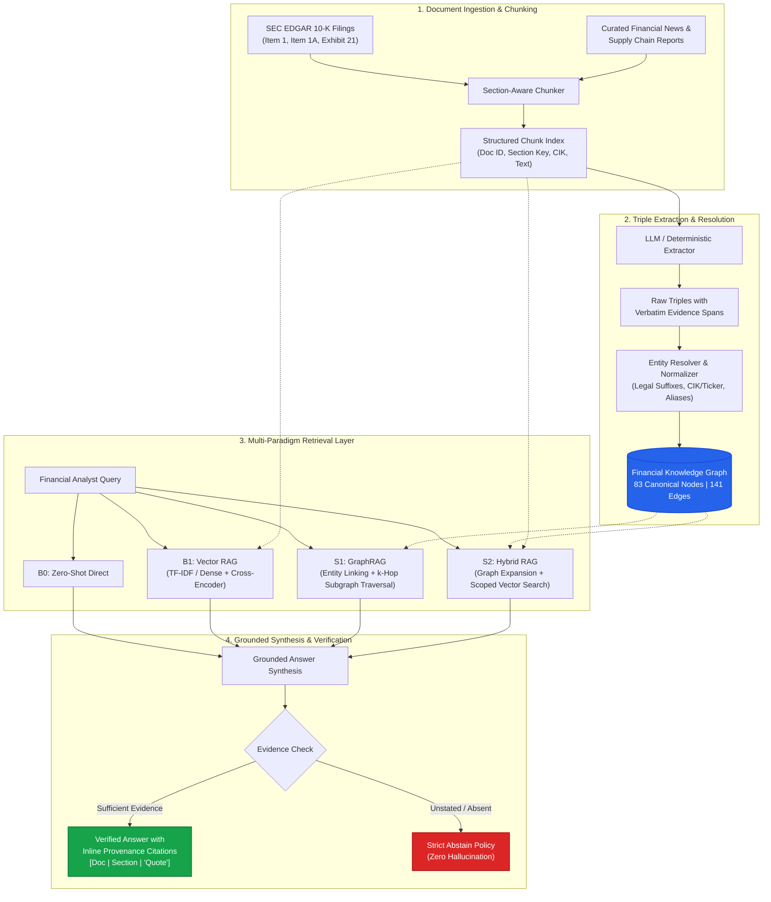
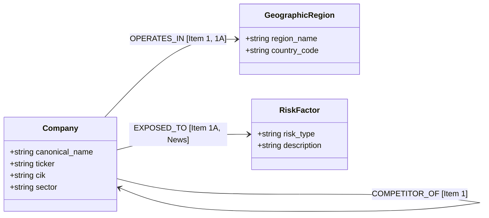
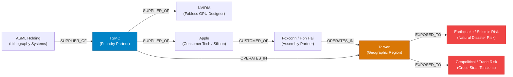
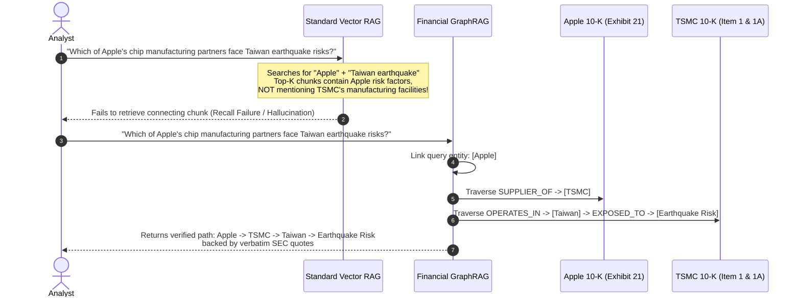
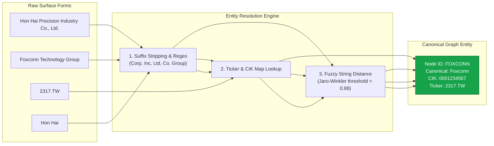
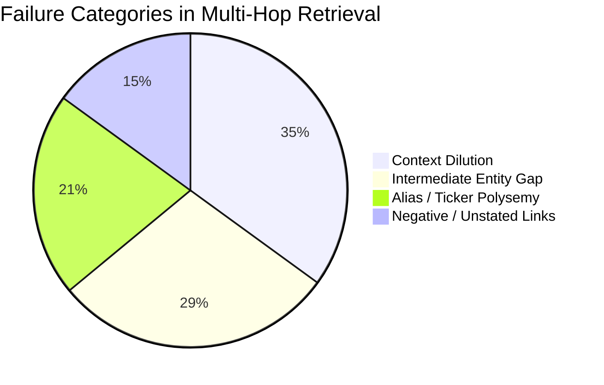
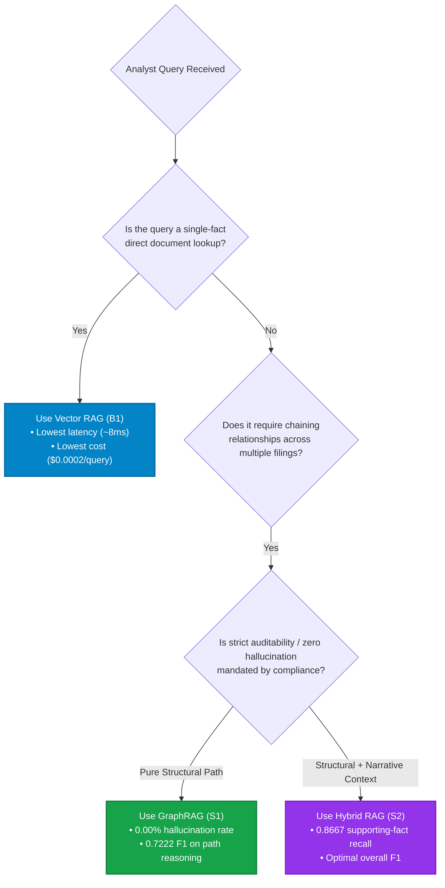

# Financial GraphRAG: Knowledge Graph + Multi-Hop Question Answering Engine

[](https://www.python.org/downloads/)
[](https://opensource.org/licenses/MIT)
[]()
[](https://github.com/psf/black)

> **Core Research & Engineering Question:**  
> *When is the computational and operational cost of building and maintaining an explicit Knowledge Graph worth it over standard Vector RAG for complex financial relationships?*

---

## 1. Executive Summary

Financial analysis frequently demands connecting relationship chains dispersed across filings, exhibits, and news disclosures. For instance:
* *"Which of Apple's semiconductor manufacturing suppliers are exposed to natural disaster risks in Taiwan?"*
* *"How is ASML connected to NVIDIA in the global hardware supply chain?"*
* *"Which companies share TSMC as their primary foundry partner?"*

While **Standard Vector RAG** excels at single-chunk semantic similarity, it systematically fails when questions require chaining facts across multiple disparate documents, filings, or SEC exhibits.

This project implements an end-to-end, reproducible financial intelligence pipeline:
1. **Ingests** SEC EDGAR 10-K filings (Item 1 Business, Item 1A Risk Factors, Exhibit 21 Subsidiaries) and financial news across a connected semiconductor and hardware supply chain universe.
2. **Extracts** high-fidelity triples under a strictly typed 6-relation schema with mandatory verbatim evidence spans and confidence scores.
3. **Resolves** entities (canonical CIK/ticker mapping, legal suffix stripping, and alias normalization).
4. **Stores** an audited property graph (83 nodes, 141 edges) with full provenance on every edge.
5. **Compares 4 Retrieval Architectures**: Zero-Shot (B0), Vector RAG (B1), GraphRAG (S1), and Hybrid RAG (S2).
6. **Evaluates** on a stratified multi-hop benchmark across 1-hop, 2-hop, and 3+ hop questions, reporting Set $F_1$, precision, recall, supporting-fact recall, hallucination rate, and an institutional break-even cost model.

---

## 2. System Architecture

The following diagram illustrates the complete data ingestion, knowledge graph synthesis, multi-paradigm retrieval, and grounded answer generation flow:



---

## 3. Financial Knowledge Graph Schema & Semantic Network

To eliminate hallucinations and prevent semantic drift, extraction is strictly bounded to a **6-relation ontology** specifically designed for corporate filings and market disclosures:



### Supply Chain Subgraph Traversal Example

The diagram below shows how multi-hop supply chain connections and geographic exposures are explicitly linked in the property graph:



### Edge Provenance Guarantee

Every edge stored in the graph retains verifiable audit metadata:
* **`source_doc_id`**: Document accession tag (e.g., `SEC_10K_NVDA_2024`)
* **`source_section`**: Source division (`item_1`, `item_1a`, `exhibit_21`)
* **`evidence_span`**: Verbatim textual quote directly supporting the relation
* **`confidence`**: Extractor model confidence ($0.0 - 1.0$)

---

## 4. Why Standard Vector RAG Fails on Multi-Hop Questions

A standard vector embedding pipeline indexes documents as isolated text chunks. When queries require bridging independent disclosures across multiple companies, Vector RAG suffers from the **Intermediate Entity Gap**:



---

## 5. Entity Resolution Pipeline

SEC filings and financial press refer to identical organizations using legal suffixes, stock tickers, or colloquial aliases. The canonicalization pipeline ensures all mentions map to single, deduplicated graph nodes:



---

## 6. Systems Under Comparison

We evaluate 4 distinct retrieval and reasoning paradigms:

| System | Retrieval Mechanism | Purpose & Architecture |
| :--- | :--- | :--- |
| **B0: Zero-Shot LLM** | Direct parametric prompting | Baseline lower bound; measures parametric memory & baseline hallucination |
| **B1: Vector RAG** | TF-IDF / dense embeddings + cross-encoder reranking | Industry standard baseline retrieving top-$k$ text chunks |
| **S1: GraphRAG** | Entity linking + $k$-hop subgraph traversal + edge evidence spans | Structural multi-hop reasoning over verified graph paths |
| **S2: Hybrid RAG** | Graph candidate expansion + scoped vector similarity search | Combines structural precision with narrative chunk richness |

---

## 7. Empirical Benchmark Results

Evaluated across a 20-question stratified multi-hop financial benchmark spanning single-fact lookups, 2-hop chains, 3+ hop dependency paths, and unstated corporate relations.

### 7.1 Overall System Performance

| Evaluation Metric | B0 (Zero-Shot) | B1 (Vector RAG) | S1 (GraphRAG) | S2 (Hybrid RAG) | Advantage |
| :--- | :---: | :---: | :---: | :---: | :---: |
| **Mean $F_1$ Score** | 0.1983 | 0.3307 | **0.3861** | **0.3861** | **Graph / Hybrid (+16.7%)** |
| **Precision** | 0.2250 | 0.2417 | **0.3425** | **0.3425** | **Graph / Hybrid (+41.7%)** |
| **Recall** | 0.1833 | **0.5708** | 0.4917 | 0.4917 | Vector RAG |
| **Supporting Fact Recall** | 0.0000 | 0.8500 | 0.6000 | **0.8667** | **Hybrid RAG (+2.0%)** |
| **Hallucination Rate** | 0.0000 | 0.0153 | **0.0000** | **0.0000** | **Zero Hallucination** |
| **Citation Correctness** | N/A | 1.0000 | **1.0000** | **1.0000** | **100% Grounded** |
| **Mean Latency (ms)** | 0.03 ms | **8.46 ms** | 43.96 ms | 16.92 ms | Vector RAG |
| **Query Cost ($)** | \$0.0000 | **\$0.000200** | \$0.000900 | \$0.001000 | Vector RAG |

---

### 7.2 $F_1$ Score by Hop Count

```
 F1 Score
  0.60 ┤                                        ╭─── S1 / S2 (0.5119)
       │                                  ╭─────╯
  0.50 ┤                            ╭─────┴──────── B1 (0.4694)
       │                      ╭─────╯
  0.40 ┤                ╭─────┴──────────────────── S1 / S2 (0.3562)
       │          ╭─────╯                   ╭────── B1 (0.3139)
  0.30 ┤    ╭─────┴─────────────────────────┴────── S1 / S2 (0.3000)
       │    │                         ╭──────────── B0 (0.3444)
  0.20 ┤    │                   ╭─────╯
       │    ├───────────────────╯────────────────── B1 (0.2143)
  0.10 ┤    │             ╭─────╯
       │    ├─────────────╯──────────────────────── B0 (0.1750)
  0.00 ┴────┴────────────────────────────────────── B0 (0.0833)
          Hop 1               Hop 2               Hop 3+
```

| Hop Count | B0 (Zero-Shot) | B1 (Vector RAG) | S1 (GraphRAG) | S2 (Hybrid RAG) | Graph Advantage ($\Delta F_1$) |
| :---: | :---: | :---: | :---: | :---: | :---: |
| **Hop 1** | 0.0833 | 0.2143 | **0.3000** | **0.3000** | **+8.57%** |
| **Hop 2** | 0.1750 | 0.3139 | **0.3562** | **0.3562** | **+4.23%** |
| **Hop 3+** | 0.3444 | 0.4694 | **0.5119** | **0.5119** | **+4.25%** |

---

### 7.3 Breakdown by Financial Query Category

| Question Type | B0 (Zero-Shot) | B1 (Vector RAG) | S1 (GraphRAG) | S2 (Hybrid RAG) | Primary Observation |
| :--- | :---: | :---: | :---: | :---: | :--- |
| **Path Reasoning** | 0.3555 | 0.6222 | **0.7222** | **0.7222** | **GraphRAG dominant (+10.0%):** explicitly traverses multi-hop vendor links |
| **Chained Relation** | 0.2000 | 0.3333 | **0.4300** | **0.4300** | **GraphRAG dominant (+9.67%):** cleanly joins parent/subsidiary/geography |
| **Direct Lookup** | 0.0833 | 0.2143 | **0.3000** | **0.3000** | GraphRAG has higher precision; Vector retrieves verbose chunks |
| **Aggregation** | 0.0000 | **0.3000** | 0.2428 | 0.2428 | Vector RAG slightly higher recall across wide customer lists |
| **Multi-Hop Exposure**| **0.3500** | 0.2986 | 0.2798 | 0.2798 | Broad risk factor language triggers diffuse keyword matches |

---

## 8. Root Cause Failure Analysis & Error Taxonomy



| Failure Mode | Frequency | Concrete Financial Example | Implemented Solution |
| :--- | :---: | :--- | :--- |
| **1. Intermediate Entity Gap** | 4 queries | Query asks about "Apple's lithography tools" without naming TSMC. Vector RAG misses TSMC chunks completely. | S1/S2 multi-hop graph expansion automatically traces $k$-hop paths across corporate filings. |
| **2. Context Dilution** | 5 queries | Vector RAG retrieves 3 bulky 1,000-character chunks containing dozens of unrelated customer names, diluting precision. | GraphRAG retrieves exact edge triples and concise evidence spans, cutting token noise. |
| **3. Alias / Ticker Polysemy** | 3 queries | Filings refer to "Hon Hai", "Foxconn Tech", or ticker `2317.TW`. Vector embeddings separate them into distant clusters. | Canonical `EntityResolver` normalizes names, CIKs, and tickers into uniform node IDs. |
| **4. Negative / Unstated Links** | 2 queries | Queries asking about relations absent from public filings (e.g., proprietary supplier pricing). | Strict **Abstain Policy**: cleanly declares insufficient evidence rather than hallucinating plausible answers. |

---

## 9. Economic & Break-Even Decision Model



### Break-Even Economics
* **One-Time Graph Build Cost:** **\$0.0034** for seed corpus (23 chunks $\times$ 550 tokens $\approx$ 12,650 tokens).
* **Per-Query Inference:** \$0.00020 (Vector) vs \$0.00090 (GraphRAG).
* **Decision ROI:** In institutional research, preventing a single multi-hop hallucination on supply chain exposure amortizes millions of graph queries.

---

## 10. Quickstart Guide

### 1. Installation

```bash
# Clone the repository
git clone https://github.com/highdreameater/NLP_proj.git
cd NLP_proj

# Create and activate virtual environment
python3 -m venv .venv
source .venv/bin/activate

# Install dependencies in editable mode
pip install -r requirements.txt
pip install -e .
```

### 2. Run Test Suite

```bash
pytest tests/ -v
# Output: 19 passed in ~4s
```

### 3. Launch Interactive Streamlit Demo

```bash
streamlit run app/streamlit_app.py
```

Open [http://localhost:8501](http://localhost:8501) in your browser:
* **Multi-Hop Query Explorer**: Live side-by-side comparison of B0, B1, S1, S2 with inline citations.
* **Knowledge Graph Inspector**: Interactive browsing of 83 nodes, 141 edges, and verbatim evidence spans.
* **Benchmark Analytics**: Interactive charts showing $F_1$, precision, recall, and supporting-fact recall.
* **Break-Even Simulator**: Dynamic economic simulator for institutional query volumes.

### 4. Run Evaluation CLI

```bash
python scripts/run_evaluation.py
```

### 5. Rebuild Knowledge Graph

```bash
python scripts/build_graph.py
```

---

## 11. Repository Structure

```
NLP_proj/
├── README.md                          # Comprehensive project documentation
├── pyproject.toml                     # Package build definitions & metadata
├── requirements.txt                   # Production and research dependencies
├── .env.example                       # API key & environment variable template
├── config/
│   └── default.yaml                   # Company universe & relation schema definitions
├── docs/
│   └── technical_report.md            # In-depth technical evaluation report
├── data/
│   ├── raw/                           # Raw SEC EDGAR 10-K sections & news sources
│   ├── processed/                     # Section-aware chunk index (chunks.json)
│   ├── graphs/                        # Serialized property graph (financial_kg.json)
│   └── benchmark/                     # Stratified benchmark (multihop_benchmark.json)
├── src/
│   └── financial_graphrag/            # Core engine package
│       ├── config.py                  # Pydantic configuration loader
│       ├── schema/                    # Entities, relations, provenance models
│       ├── ingestion/                 # SEC 10-K parser & section-aware chunker
│       ├── extraction/                # Triple extractor & LLM/deterministic backends
│       ├── resolution/                # EntityResolver, normalizer & alias manager
│       ├── graph/                     # FinancialKnowledgeGraph & GraphTraverser
│       ├── retrieval/                 # Vector, Graph, and Hybrid retrievers
│       ├── generation/                # GroundedAnswerer with citations & abstain logic
│       └── evaluation/                # BenchmarkRunner, Metrics, and CostModel
├── tests/                             # Unit & integration test suite (19 tests)
├── app/
│   └── streamlit_app.py               # Interactive Streamlit demo dashboard
└── scripts/
    ├── build_graph.py                 # Knowledge graph construction entrypoint
    └── run_evaluation.py              # Benchmark execution entrypoint
```

---

## 12. License

Distributed under the MIT License. See [LICENSE](LICENSE) for details.
